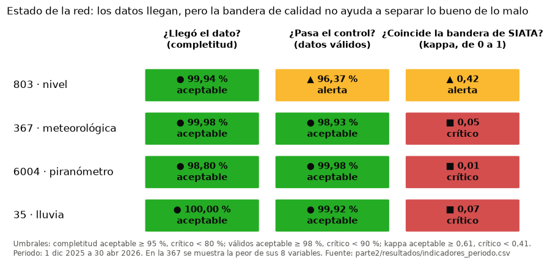

# Prueba técnica SIATA - Profesional en Ciencia de Datos

Julián Pastrana

En este repositorio está mi solución de la prueba técnica. Trabajé con los datos de cuatro estaciones de SIATA entre el 1 de diciembre de 2025 y el 30 de abril de 2026, con un registro por minuto: la meteorológica 367, la de nivel 803, el piranómetro 6004 y la pluviométrica 35.

## Resumen ejecutivo

La pregunta de fondo es si estos datos sirven para emitir alertas y para los productos que publica SIATA. En general los datos llegan casi completos, pero no todo lo que llega es correcto, y la columna de calidad que acompaña cada dato no alcanza para separar lo bueno de lo malo.



### Hallazgos principales

1. La estación de nivel 803 reporta crecientes que no ocurrieron. Entre el 2 y el 8 de diciembre y entre el 10 y el 17 de marzo hay mesetas de hasta 344 cm que duran horas, y el 94,6 % de esos minutos no tiene lluvia en la 35 en las 3 horas previas. Para comparar, el aguacero más fuerte del periodo, 43,6 mm el 3 de abril, subió el nivel solo a 30 cm. SIATA marca esas mesetas como dudosas, pero quien no revise la bandera las toma como crecientes.
2. En la 367 hay fallas del anemómetro publicadas como dato bueno. La velocidad media más alta del periodo, 13,5 m/s el 5 de marzo, es una lectura trabada de 9 minutos que salió con calidad 1. En total hay 21 minutos con ese patrón y 17 tienen calidad 1. Además, la dirección de la ráfaga no funciona cuando el viento viene del sureste.
3. El piranómetro 6004 está en UTC y las demás estaciones en hora de Colombia, así que sus datos quedan corridos 5 horas. Esto solo aparece en una de las guías generales de la red, no en el archivo ni en la ficha de la estación.
4. La columna de calidad cambia de criterio dentro del periodo. Por ejemplo, en la 803 la regla de niveles negativos solo se aplicó en diciembre, y en el piranómetro hay minutos marcados como "radiación de noche" con el sol arriba. Al compararla con un control propio basado en las pruebas de la OMM, el acuerdo es moderado en la 803 y bajo en las otras tres.
5. Los dos pluviómetros del mismo sitio no miden lo mismo: la 367 registra el 32 % de la lluvia de la 35 (268,6 frente a 848,1 mm). La 35 debería ser la referencia de cantidad y la 367 solo sirve para saber si llueve.
6. Faltan pocos datos (la completitud va de 98,8 % a 99,997 %), pero algunos llegan tarde. Del 14 al 16 de diciembre la 35 no transmitió en tiempo real y esos datos se recuperaron después. Para alertas también hay que medir la oportunidad.
7. La temperatura y la radiación se pueden pronosticar hasta 24 horas con 15 % y 16 % menos error que repetir el día anterior. La lluvia solo se anticipa como probabilidad en las primeras horas y con poca evidencia, y el nivel de la quebrada no se logra anticipar, así que la alerta debe apoyarse en la lluvia medida y en el radar.
8. Dejé una tabla con 815 eventos de anomalía clasificados en fallas de sensor (361), fallas de comunicación (250), eventos reales (197) y problemas de configuración (7). Los eventos reales, como el aguacero del 3 de abril, se reportan pero no se borran.

### Recomendaciones

| Plazo | Acción | Para qué |
|---|---|---|
| 30 días | Sacar de las alertas automáticas los niveles dudosos de la 803, aplicar la regla de nivel alto sin lluvia y revisar el sensor en campo | Evitar falsas alarmas de creciente |
| 30 días | Marcar la ráfaga trabada y revisar el anemómetro de la 367 | Que una falla no dispare una alerta de viento |
| 30 días | Declarar la zona horaria en los metadatos de cada archivo y publicar la 6004 en hora de Colombia | Poder cruzar estaciones sin errores |
| 90 días | Publicar el diccionario de códigos con cada estación, versionar el algoritmo de calidad y reprocesar el histórico con una sola versión | Que la bandera signifique lo mismo en todo el periodo |
| 90 días | Usar la 35 como referencia de lluvia en La Ladera y revisar en campo el pluviómetro de la 367 | Acumulados correctos para los umbrales de alerta |
| 180 días | Aplicar las pruebas de la OMM para estaciones automáticas y seguir la red con tres indicadores: completitud, datos válidos y confiabilidad de la bandera | Detectar fallas en horas y no en semanas |

### Limitaciones

Son solo cinco meses y no tuve la bitácora de mantenimiento ni los metadatos de los sensores. Tampoco hay una verdad de referencia, así que el control propio también puede equivocarse, y algunos de sus umbrales los ajusté con estos mismos datos. Los códigos de calidad los inferí de los datos y después los comparé con las guías de cada red: coinciden en los 21 casos.

## Contenido del repositorio

| Ruta | Contenido |
|---|---|
| [parte1/](parte1/) | Respuestas de la Parte 1 |
| [parte2/README.md](parte2/README.md) | Informe técnico de la Parte 2 (tareas A a F) |
| [parte2/siata/](parte2/siata/) | Código en Python: carga de datos, reglas de calidad, indicadores, series de tiempo, anomalías, correlaciones y el pipeline |
| [parte2/notebooks/](parte2/notebooks/) | Un notebook por estación, uno comparativo y uno por tarea, ejecutados con sus salidas |
| [parte2/tests/](parte2/tests/) | Pruebas automáticas (pytest) |
| [parte2/resultados/](parte2/resultados/) | Resultados agregados: indicadores, métricas de pronóstico, eventos de anomalía y correlaciones |
| [parte2/figuras/](parte2/figuras/) | Figuras de los informes |
| [parte2/dashboard.py](parte2/dashboard.py) | Dashboard en Streamlit |

Los datos de la prueba no están en el repositorio porque son de uso exclusivo para la evaluación. El código no modifica los CSV originales.

## Cómo ejecutarlo

Se necesita Python 3.13. Todo se corre desde la raíz del repositorio.

1. Crear el entorno e instalar las dependencias:

   ```bash
   python -m venv .venv
   source .venv/Scripts/activate        # en Windows con cmd: .venv\Scripts\activate
   pip install -r requirements.txt
   ```

2. Copiar los cuatro CSV de la prueba en `docs/Datos Prueba Tecnica/`.

3. Correr el control de calidad. Genera `parte2/salidas/` y los indicadores de `parte2/resultados/`:

   ```bash
   cd parte2
   python -m siata.pipeline
   cd ..
   ```

4. Correr las pruebas:

   ```bash
   pytest
   ```

5. Abrir el dashboard (si no se hizo el paso 3, lo corre solo la primera vez):

   ```bash
   streamlit run parte2/dashboard.py
   ```

6. Para volver a ejecutar los notebooks: `python parte2/ejecutar_notebooks.py`. También se pueden abrir en VS Code con el kernel de `.venv`.

## Supuestos principales

Están explicados con su evidencia en el [informe técnico](parte2/README.md#supuestos-documentados). Los más importantes son que la 6004 viene en UTC y las demás en hora local, que el -999 significa "sin lectura" y nunca se toma como 0 mm, que el código de calidad 2 es un dato confiable que llegó tarde y que el nivel de la 803 se mide sobre un cero de referencia que no está documentado.

## Herramientas

Python con pandas, NumPy, SciPy, statsmodels, scikit-learn, Matplotlib, seaborn, Plotly, Streamlit y pytest. Usé Claude Code como apoyo para programar y para revisar la redacción.
