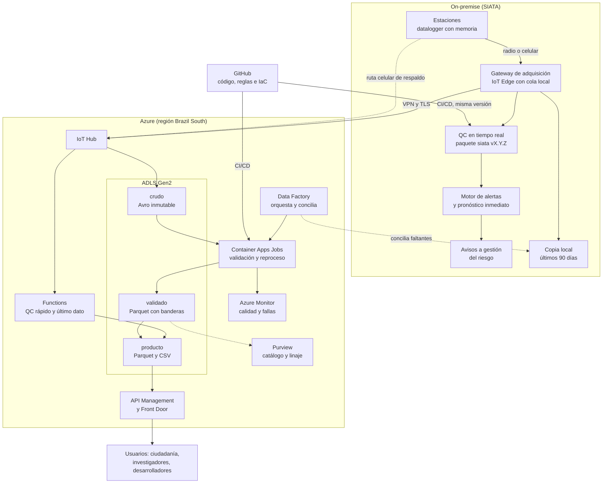

# 2.4 Computación en la nube, modelos híbridos y repositorios

## Pregunta 1.7. Arquitectura de datos en la nube e híbrida (Azure)

> **Pregunta 1.7 (arquitectura en la nube e híbrida).** SIATA recibe datos por minuto desde cientos de estaciones y sus alertas son críticas para la ciudad. Diseñe una arquitectura de datos para ingesta, validación, almacenamiento y publicación, sobre la nube de su preferencia (AWS, Google Cloud o Azure) o sobre un **modelo híbrido** (infraestructura propia *on-premise* más nube). Entregue un diagrama y una justificación que cubra:
>
> **(a)** Conceptos base: modelos de servicio (IaaS, PaaS, SaaS) y de despliegue (pública, privada, híbrida), y cuál elegiría para SIATA y por qué.
>
> **(b)** Capas de almacenamiento (crudo, validado, producto) y formatos (por ejemplo Parquet, particionamiento).
>
> **(c)** Orquestación, cómputo y estrategia de reprocesamiento (idempotencia).
>
> **(d)** Modelo híbrido: qué componentes mantendría *on-premise* y cuáles llevaría a la nube (ver tabla), cómo sincroniza ambos entornos y cómo garantiza la continuidad operativa si se cae el enlace o el proveedor.
>
> **(e)** Repositorio de calidad en la nube: cómo dispondría el catálogo de datos, el diccionario de variables y banderas, las reglas de validación versionadas, el linaje, los indicadores de calidad y las salidas para el usuario (API y datos abiertos), con control de acceso por rol, retención, respaldo y recuperación ante desastres (metas RPO y RTO).
>
> **(f)** Seguridad y cumplimiento: gestión de identidades, cifrado, principio de mínimo privilegio y normativa aplicable en Colombia (por ejemplo, protección de datos personales).
>
> **(g)** Observabilidad: monitoreo de la calidad y alertas ante falla de estaciones.
>
> **(h)** Costos: estimación cualitativa (incluidos los costos de salida de datos) y tres decisiones para controlarlos.
>
> **(i)** Infraestructura como código y despliegue continuo.
>
> Complete esta tabla para el ítem (d): componente, *on-premise*, nube y justificación.

Propongo un modelo híbrido con Azure que parte de una regla: la cadena que produce las alertas (estación, adquisición, control de calidad rápido, modelo y aviso) no puede depender de internet ni de la nube. La nube guarda el histórico con varias copias, reprocesa, cataloga y publica. Hoy los datos del repositorio están en servidores propios y el portal usa Dataverse (términos de uso de SIATA, borrador de abril de 2026), así que se suma la nube sin quitar lo local.

El volumen es manejable: 500 estaciones minutales son unos 263 millones de registros al año, y si se parecieran a las cuatro de la prueba (38,4 MB en CSV para 151 días; las salidas minutales del pipeline, en Parquet y con las banderas, ocupan 9,0 MB) serían unos 12 GB al año en CSV y unos 3 GB en Parquet (supuesto). Lo difícil es la latencia de las alertas, la trazabilidad de las banderas y el reprocesamiento, así que basta con contenedores que procesan una estación y un mes a la vez, sin un clúster de Spark.



### (a) Conceptos base: modelos de servicio y de despliegue

En IaaS el proveedor entrega máquinas, red y discos, y SIATA administra sistema operativo y software; en PaaS el proveedor administra la plataforma y SIATA pone código y datos (ADLS Gen2, IoT Hub, Functions, Data Factory); en SaaS se usa una aplicación terminada (GitHub, Power BI). La nube pública es infraestructura compartida que se paga por uso, la privada es dedicada a una organización y la híbrida conecta las dos.

Elijo el modelo híbrido por tres razones: las alertas no pueden depender de un enlace ni de un tercero (entre la lluvia en la 35 y el pico del nivel en la 803 pasan 25 minutos en la mediana de los 47 eventos de 5 mm o más, parte 2); SIATA ya opera infraestructura propia; y lo analítico gana con la nube (copias en otra región, capacidad para los picos de consulta, menos servidores que administrar). Dentro de Azure prefiero PaaS, porque un equipo pequeño no debería gastar su tiempo parchando servidores.

Azure no tiene región en Colombia. Elijo Brazil South, que tiene tres zonas de disponibilidad y región pareada (South Central US), a la que replica el almacenamiento geo-redundante (GRS); Chile Central y Mexico Central no tienen par. Queda sujeto a una prueba de latencia desde Medellín, y los datos quedan fuera del país (ver f).

### (b) Capas de almacenamiento y formatos

Las tres capas son contenedores separados de una cuenta ADLS Gen2, para que permisos y retención sean distintos por capa.

- Crudo: lo que llegó, tal cual. IoT Hub lo escribe en Avro, en lotes de 60 a 720 segundos y en rutas por hora de llegada. No se convierte, porque convertir ya es transformar. Tiene política WORM de contenedor (Azure la admite con espacio de nombres jerárquico) y retención permanente, como piden los términos de uso para las series históricas.
- Validado: Parquet con zstd, una fila por estación y minuto en la malla completa (huecos con bandera 9), con el valor original, la `calidad` de SIATA, la bandera propia por variable, la `version_algoritmo` y la corrida. Partición `red=/estacion=/anio=/mes=` por fecha de medición en UTC; la zona de origen va en los metadatos de la estación, porque la 6004 llega en UTC y las otras en hora local, algo que hoy solo dice la guía de piranómetros (P-GAA-SIATA-111, p. 3). La partición estación-mes es la unidad de reproceso.
- Producto: series horarias y diarias con la regla de agregación de cada variable (suma para la lluvia, máximo para la ráfaga, media vectorial para la dirección, con cobertura mínima), último dato, indicadores y datos abiertos por estación y año en CSV y Parquet, cada uno marcado como provisional o definitivo.

Basta con Parquet simple escrito en una carpeta temporal y renombrado; si varios procesos llegan a escribir la misma tabla, se pasa a Delta Lake.

### (c) Orquestación, cómputo y estrategia de reprocesamiento

En tiempo casi real, Functions lee el punto integrado de IoT Hub, compatible con Event Hubs, aplica rango, salto, hueco y persistencia corta y publica el último dato como provisional. Al crear la ruta hacia el almacenamiento hay que crear otra hacia ese punto, o deja de recibir. Las mismas reglas, con la misma versión, corren *on-premise* para las alertas.

Por lotes, Data Factory programa y Container Apps Jobs corre el paquete `siata` en contenedores que se apagan al terminar, una estación y un mes por ejecución. Ahí entran las reglas que necesitan contexto, como la persistencia de 6 horas del nivel o la comparación de la 367 con la 35. Data Factory también concilia con lo local mediante un *integration runtime* autohospedado.

El reprocesamiento es idempotente (correrlo una o diez veces da lo mismo) por cuatro decisiones:

1. Clave natural `(codigo, fecha_hora)` en UTC con regla determinista para duplicados, que llegan porque IoT Edge entrega "al menos una vez": gana el primero, como hace `regularizar` cuando una de las 15 marcas con segundos de la 6004 choca con un minuto existente.
2. Cada corrida depende solo de la partición del crudo, la versión del algoritmo y los metadatos vigentes de la estación (por ejemplo, la distancia del sensor al fondo de la 803).
3. En el validado se reescribe la partición completa, nunca se agrega al final.
4. Lo que llega tarde dispara el reproceso solo de los pares estación-mes afectados, como los 2944 minutos de la 35 con código 2, "calidad confiable del dato no obtenido en tiempo real" (P-GAA-SIATA-107, p. 6).

Cuando cambia el algoritmo, el histórico se reprocesa y se publica tras comparar indicadores entre versiones, para que no se repita lo de la 803, donde el 1504 marca niveles negativos solo en diciembre y de enero a abril 7325 de los 8692 negativos salen con 1, sin versión publicada.

### (d) Modelo híbrido

| Componente | On-premise | Nube | Justificación |
|---|---|---|---|
| Adquisición y *buffer* local en estación o centro de datos | Datalogger con memoria y gateway con IoT Edge y cola en disco. | Solo recibe (IoT Hub); las estaciones críticas tienen ruta celular directa. | La cola local evita perder datos si cae el enlace. IoT Edge guarda 2 horas por defecto; hay que subirlo a 7 días, porque hubo un hueco de más de un día (1752 minutos en la 6004). |
| Datos crudos históricos | Últimos 90 días. | Copia maestra inmutable y geo-redundante. | Durabilidad y retención permanente en la nube; lo local basta para operar sin internet. |
| Validación y control de calidad | Reglas rápidas para las alertas. | Cadena completa y reproceso del histórico. | Mismo paquete y versión en los dos lados; lo que necesita contexto es más barato por lotes. |
| Repositorio de calidad (catálogo, banderas, reglas) | Copia de solo lectura de reglas y umbrales. | Fuente de verdad: reglas en Git, catálogo y linaje en Purview. | Las reglas cambian en un solo lugar y lo local nunca queda sin ellas. |
| Publicación para usuarios (API, datos abiertos) | Página de contingencia con el último dato. | API Management, Front Door y descargas; Dataverse para los DOI. | En una emergencia la consulta se dispara y no debe cargar la red operativa. |
| Modelos y alertas de operación crítica | Motor de alertas y pronóstico inmediato. | Entrenamiento y réplica en espera del motor. | La alerta debe salir sin internet; entrenar con años de datos es trabajo de nube. |

Sincronización. De local a nube, el gateway envía cada minuto a IoT Hub por VPN, con dos proveedores de internet; cada mensaje lleva un número de secuencia y la clave natural evita duplicados. Una conciliación diaria compara por estación y día los minutos de los dos lados (se esperan 1440) y copia los que falten. De nube a local solo bajan artefactos versionados: el paquete con sus reglas, los metadatos de estación y los modelos.

Continuidad. Si cae el enlace, las alertas siguen, la cola entrega en orden al volver y el portal avisa "datos con retraso desde las HH:MM". Si cae la región o el proveedor, se pierde la publicación, no la alerta: el crudo está replicado en South Central US, la plataforma se redespliega desde el código y la conmutación la decide SIATA con un procedimiento ensayado (Microsoft solo conmuta una cuenta GRS como último recurso). Si cae el centro de datos propio, las estaciones críticas tienen doble ruta y el motor de alertas, una réplica en Azure probada en simulacros.

### (e) Repositorio de calidad en la nube

- Catálogo: Microsoft Purview registra cada activo (red, estación, variable, capa) con responsable, licencia y clasificación (pública, de acceso controlado y restringida, como en los términos de uso). Sirve como Registro de Activos de Información (Ley 1712 de 2014, art. 13).
- Diccionario de variables y banderas: un archivo versionado en Git, publicado en Purview y en la API, que parte de las guías por red de SIATA (P-GAA-SIATA-107, 108, 110 y 111) y corrige sus inconsistencias (el 1504 descrito igual que el 1502 en la guía del nivel, p. 5; faltante -999 o -9999 según la red; el 1567, ausente de la tabla meteorológica), con la equivalencia a las banderas 1/2/3/4/9 y los metadatos WIGOS de cada estación.
- Reglas versionadas: `calidad.py` con `UMBRALES` y la referencia de cada umbral, etiquetas SemVer y cambios solo por *pull request* (ver 1.8).
- Linaje: Purview toma automáticamente el de Data Factory (Copy, Data Flow, SSIS); la validación en Container Apps se registra con su API REST. Cada archivo del validado lleva además su corrida, con el crudo leído y la versión.
- Indicadores: los tres de la 1.3 por estación, variable y día, con los umbrales de `indicadores.py` (completitud 95 % y 80 %, válidos 98 % y 90 %, kappa 0,61 y 0,41), publicados junto a los datos.
- Salidas: API REST en API Management con bandera, versión y estado provisional o definitivo, con cuotas por clave; datos abiertos por estación y año con diccionario, licencia y DOI, registrados en datos.gov.co. La API guarda qué versión descargó cada clave: si una estación reporta valores congelados 48 horas y un cliente institucional ya los descargó, se sabe a quién avisar y qué corrección entregarle.
- Acceso por rol: usuario general (producto público), usuario de acceso controlado (previa solicitud), analista de calidad, ingeniero de datos y administrador; la ingesta solo escribe en crudo y la validación lee crudo y escribe validado y producto. Se hace con grupos de Entra ID, RBAC y ACL de ADLS Gen2.
- Retención: crudo y validado permanentes y registros de acceso por cinco años o más, según los términos de uso. El crudo pasa a *cool* a los 90 días y a *cold* al año, ambos en línea; *archive* solo para una segunda copia, porque rehidratar puede tardar hasta 15 horas.
- Respaldo: el crudo tiene WORM, réplica geográfica (RA-GRS) y borrado temporal, además del datalogger y la copia local; validado y producto se regeneran desde el crudo.

| Capa o servicio | RPO | RTO | Por qué |
|---|---|---|---|
| Adquisición y alertas (*on-premise*) | 0 | 5 min | Con 25 minutos de mediana de la lluvia al pico, recuperar en más de 5 deja poco margen; el datalogger guarda lo no transmitido. |
| Crudo (nube) | 15 min | 24 h | La réplica geográfica es asíncrona (Azure la estima bajo 15 minutos, sin garantía); el faltante sale de la cola local. |
| Validado | 24 h | 48 h | Se regenera desde el crudo: perderlo cuesta cómputo, no datos. |
| Producto y API pública | 1 h | 4 h | Mientras tanto, la página local muestra el último dato. |
| Reglas, diccionario y catálogo | 0 (reglas), 24 h (catálogo) | 24 h | Las reglas están en Git y cada despliegue trae las suyas. |

### (f) Seguridad y cumplimiento

Identidades: Entra ID con MFA, administración temporal (Privileged Identity Management), identidades administradas para los servicios y OIDC para GitHub Actions, sin contraseñas en el código. Cifrado: AES de 256 bits en reposo por defecto en Azure Storage, con claves propias en Key Vault para datos personales; TLS 1.2 o superior y VPN con IPsec en tránsito; crudo, validado y Key Vault solo con puntos de acceso privados. Mínimo privilegio: cada identidad con el permiso de su capa, nadie borra el crudo, ambientes en suscripciones separadas y producción solo por CI/CD.

Normativa colombiana (mi lectura; el área jurídica del AMVA debe confirmarla):

- Ley 1581 de 2012. Las mediciones no son datos personales (art. 3, literal c), pero las cuentas de acceso controlado, los registros de acceso y los contactos para avisos sí, y exigen seguridad y circulación restringida (art. 4, literales g y f) y conservación sin adulteración ni pérdida (art. 17, literal d). Según los términos de uso, el AMVA es la entidad responsable del repositorio y EAFIT la encargada del tratamiento de datos personales; el proveedor de nube sería otro encargado.
- Decreto 1377 de 2013. Alojar esos datos en Brasil con Microsoft como encargado es una transmisión internacional (art. 3, numeral 5), que no exige informar al titular si hay contrato de transmisión (arts. 24 y 25); transferirlos a otro responsable en un país sin protección adecuada está prohibido (Ley 1581, art. 26).
- Ley 1712 de 2014. El AMVA es sujeto obligado (art. 5, literal a); la información debe ser "oportuna, objetiva, veraz, completa, reutilizable, procesable" (art. 3), los datos abiertos van en formatos estándar e interoperables (art. 6, literal j; art. 11, literal k) y, por gratuidad (art. 3), el costo de salida de datos no se le pasa al usuario.

### (g) Observabilidad

Azure Monitor recibe las métricas de IoT Hub e IoT Edge (mensajes, cola, tiempo fuera de línea), las fallas de los trabajos y la latencia entre medición y llegada. El trabajo diario escribe los tres indicadores de la 1.3 y avisa al analista cuando uno cruza a alerta o crítico; por ejemplo, el kappa de la 803 (0,42, alerta) y el de las otras tres (0,008 a 0,07, crítico) no señalan estaciones dañadas, sino banderas que no coinciden.

Alertas de falla de estación, en los dos entornos:

- Silencio: sin datos en 5 minutos para lluvia y nivel en cuencas con alerta, 30 para meteorológicas y 60 para el resto (valores de partida para calibrar).
- Valor congelado: las reglas de persistencia de `UMBRALES`; el escenario de 48 horas congeladas se detecta en la primera hora para la temperatura.
- Reloj desfasado: el pico de radiación debe caer cerca del mediodía solar; así se habría visto que la 6004 está en UTC (pico medio a las 17 h del archivo).
- Cambio en la `calidad` de origen: un código que aparece o desaparece de golpe, como el 1504 de la 803.

Una sola alerta por incidente y estación, con cierre automático. Azure Monitor avisa al equipo técnico (sus SMS no pasan de uno cada cinco minutos por número); la alerta pública sale de los canales propios de SIATA.

### (h) Costos

El mayor riesgo es la salida de datos: entrar a Azure no se cobra y sacar hacia internet u otra región sí, por GB, y se dispara en las emergencias, cuando no se puede limitar el acceso ni cobrarle al usuario. Siguen Log Analytics (por volumen ingerido), IoT Hub (unidades con cupo diario de mensajes en bloques de 4 KB), el cómputo (escala a cero, pero no si se reprocesa todo), los servicios con tarifa base (Purview, API Management, Front Door) y el almacenamiento, que crece lento.

Tres decisiones para controlarlos:

1. Reducir los bytes que salen: productos horarios y diarios por defecto, minutal en Parquet (unas cuatro veces más liviano que el CSV en los datos de la prueba), archivos cerrados en la caché de Front Door y cuotas en la API.
2. Agrupar antes de enviar y de escribir: un mensaje por minuto con todas las estaciones del gateway, en vez de uno por estación, gasta menos bloques de 4 KB sin agregar latencia, y los archivos estación-mes evitan miles de archivos diminutos.
3. Pagar solo lo que se usa: trabajos que escalan a cero, reproceso solo de las particiones afectadas, ciclo de vida del almacenamiento y presupuestos con alertas en Azure Cost Management; el motor de alertas sigue en la sede, donde el hardware ya existe.

No doy precios, porque dependen de la región, el contrato y la fecha; se calculan con la calculadora de Azure y estos volúmenes.

### (i) Infraestructura como código y despliegue continuo

Bicep (nativo de Azure, sin archivo de estado que custodiar), con módulos en `infra/` para cada servicio, las redes y las reglas de alerta, y parámetros por ambiente. GitHub Actions corre en cada *pull request* `pytest`, la compilación de Bicep y `what-if`; al fusionar, construye la imagen y la despliega en desarrollo y en pruebas con una estación sintética; producción exige aprobación manual. La sede recibe la misma imagen por el manifiesto de IoT Edge, volver atrás es desplegar la etiqueta anterior y un `what-if` periódico detecta cambios hechos a mano.

## Pregunta 1.8. Flujo de trabajo con Git para un equipo de cinco personas

> **Pregunta 1.8 (repositorios).** Describa el flujo de trabajo con Git que implementaría para un equipo de cinco personas que mantiene código de validación de datos. Incluya estrategia de ramas, convención de *commits*, revisión de código, pruebas automáticas (CI), gestión de versiones del algoritmo de calidad, manejo de datos grandes y de secretos, y qué debe contener un buen *README*.

Ramas. Desarrollo basado en tronco: `main` protegida y siempre desplegable, ramas `feat/...` o `fix/...` de uno a tres días y fusión *squash* por *pull request*. GitFlow sobra para cinco personas; la única rama larga es `release/1.4`, creada desde la etiqueta `v1.4.0` cuando hay que corregir una versión desplegada después de que `main` avanzó. Una regla nueva puede entrar en "modo sombra": calcula banderas sin publicarlas hasta revisar su efecto.

*Commits*. Conventional Commits, con el módulo como alcance y `!` cuando un cambio rompe a los consumidores; CI valida el formato. Por ejemplo:

```text
feat(calidad): persistencia de 6 h para el nivel
fix(datos): llevar al minuto las marcas con segundos de la 6004
feat(calidad)!: esquema de banderas 1/2/3/4/9 en lugar de los códigos de origen
```

Revisión. Todo cambio con una aprobación y CI en verde. `CODEOWNERS` exige para `calidad.py` a la persona líder de calidad y a alguien del dominio, porque un umbral es una decisión técnica. La plantilla pregunta qué cambia, con qué referencia (OMM, BSRN, datos), cuántas banderas cambian por estación y si obliga a reprocesar.

Pruebas (CI). Estilo (ruff); pruebas unitarias con casos sintéticos (valor congelado, ráfaga menor que la media, cuádruple cero frente a calma, media circular), como las 34 de `parte2/tests/test_calidad.py`, de 76 en todo `parte2/tests/`, cada regla con un caso que marca y uno que no; regresión de banderas sobre un conjunto de referencia guardado fuera de Git; e idempotencia (dos corridas, salida idéntica).

Versiones del algoritmo. SemVer por efecto sobre los datos: mayor si cambia el esquema de banderas, menor si cambian banderas para los mismos datos, parche si no cambia ninguna; lo decide la prueba de regresión. Cada versión lleva etiqueta y *release* con el conteo de banderas que cambian, y cada fila del validado guarda `version_algoritmo`, para que un cambio de criterio como el del 1504 quede a la vista.

Datos grandes y secretos. Los datos no van a Git: aquí el `.gitignore` excluye `docs/`, `*.csv` y `*.parquet` y solo deja los CSV agregados de `parte2/resultados/` (indicadores, métricas y eventos); en operación, el par (partición del crudo, versión) reproduce cualquier salida y DVC sobre ADLS guarda el conjunto de referencia. Los secretos viven en Key Vault, se leen con identidades administradas y en CI con OIDC; el escaneo de secretos de GitHub bloquea el *push* y un *hook* de *pre-commit* (gitleaks) revisa antes. Un secreto filtrado se revoca y se rota, porque reescribir el historial no alcanza.

*README*. En el orden en que lo usa alguien nuevo: qué es y su alcance; resultados en lenguaje sencillo; instalación con versiones fijas; de dónde salen los datos y por qué no están en el repositorio; un comando por paso (pipeline, pruebas, notebooks, tablero); estructura de carpetas; supuestos y limitaciones con evidencia (por ejemplo, la 6004 en UTC); banderas y diccionario; versión y cambios; cómo contribuir; licencia, cita y contacto; y herramientas usadas, incluida la IA, con lo que se validó por cuenta propia.

## Referencias

- Ley 1581 de 2012 (arts. 3, 4, 17 y 26), Decreto 1377 de 2013 (arts. 3, 24 y 25) y Ley 1712 de 2014 (arts. 3, 5, 6, 11 y 13), texto del Gestor Normativo de Función Pública.
- SIATA (2024). Generalidades Repositorio de Datos, guías P-GAA-SIATA-107, 108, 110 y 111, versión 01. SIATA (2026). Términos y condiciones de uso, Repositorio de Datos SIATA, V1, borrador.
- Microsoft Learn (consultado el 25 de octubre de 2026): regiones y pares de regiones; almacenamiento inmutable (WORM de contenedor); niveles de acceso; redundancia y conmutación de Azure Storage; puntos de conexión y cuotas de IoT Hub; capacidades sin conexión de IoT Edge; Container Apps Jobs; linaje de Purview con Data Factory y API REST; cifrado de Azure Storage; límites de Azure Monitor; Bicep con GitHub Actions.
- Conventional Commits 1.0.0 y Semantic Versioning 2.0.0.
