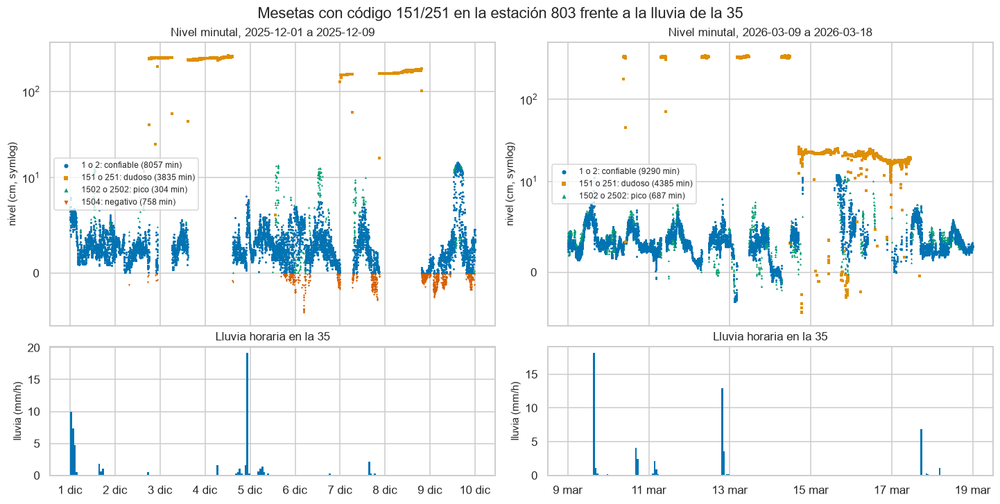
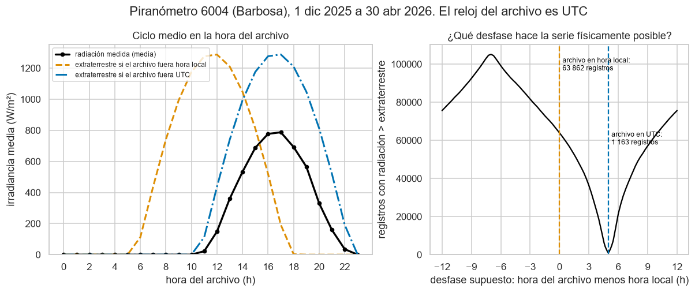
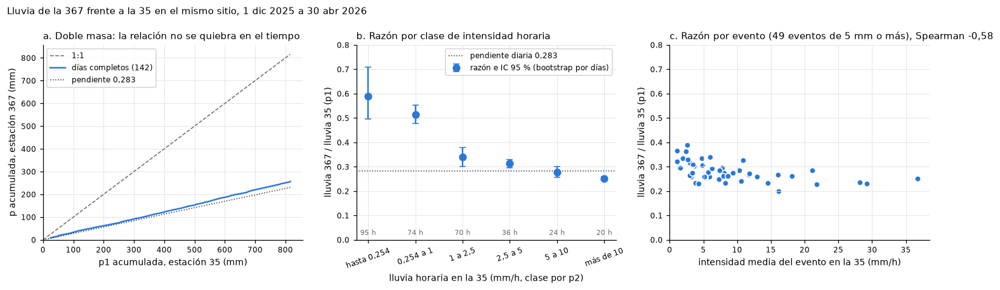
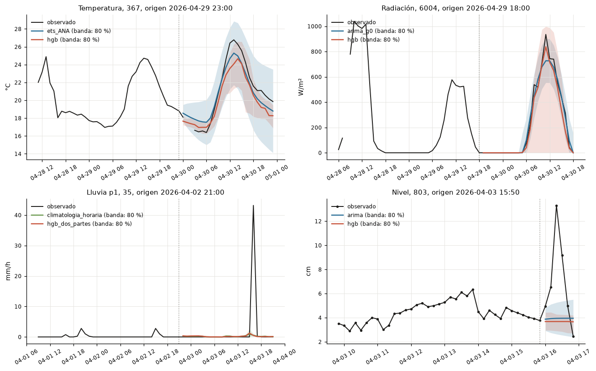
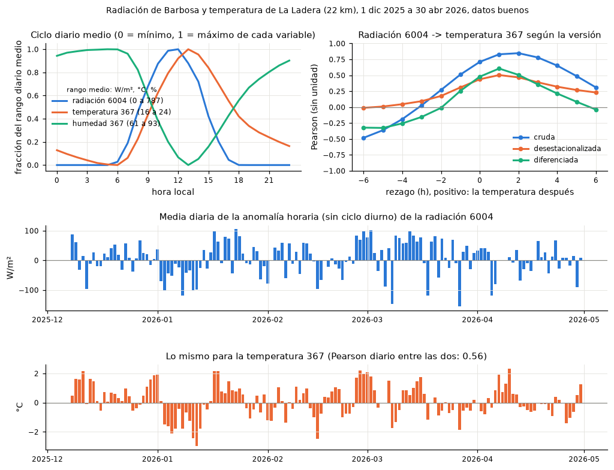
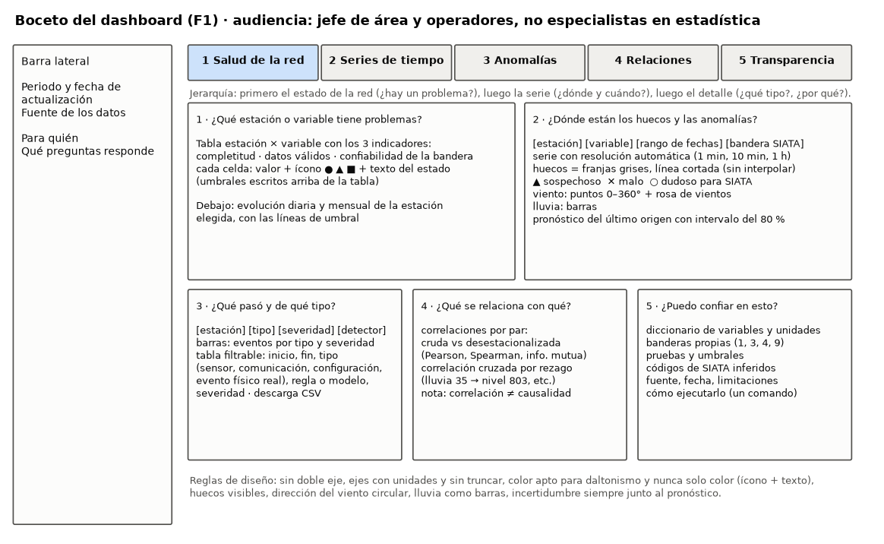
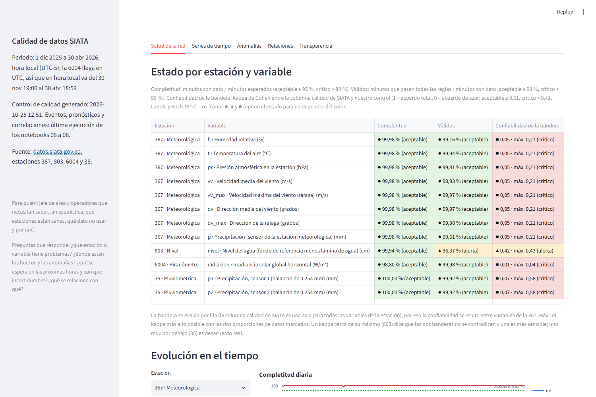
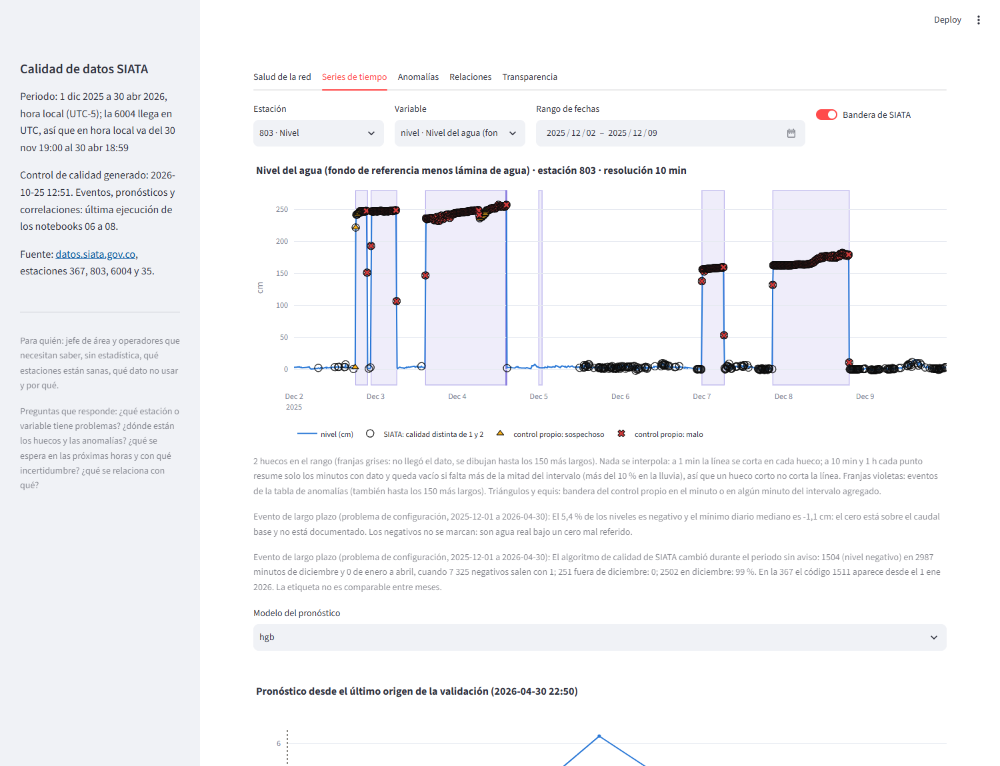

# Parte 2: informe técnico

Detalle técnico de las tareas A a F. El resumen ejecutivo para un jefe de área está en el [README principal](../README.md). Toda cifra de este informe sale del código del repositorio: del paquete `siata/`, de los notebooks de `notebooks/` (ejecutados, con sus salidas) o de los archivos de `resultados/` y `salidas/`.

| Tarea | Dónde está |
|---|---|
| A. EDA | `notebooks/01` a `05` (uno por estación y uno comparativo) |
| B. Series de tiempo | `siata/series.py`, `notebooks/06_series_tiempo.ipynb` |
| C. Anomalías | `siata/calidad.py` (reglas), `siata/anomalias.py`, `notebooks/07_anomalias.ipynb` |
| D. Correlaciones | `siata/relaciones.py`, `notebooks/08_correlaciones.ipynb` |
| E. Reproducibilidad | `siata/pipeline.py`, `tests/`, `ejecutar_notebooks.py`, `../requirements.txt` |
| F. Dashboard | `dashboard.py`, `figuras/F1_boceto_dashboard.png` |

## Datos y supuestos

### Diccionario de datos reconstruido

No se entregó diccionario con los datos. Lo reconstruí desde los datos, las fichas de cada estación en datos.siata.gov.co y la ficha técnica de la 6004. Después encontré las guías "Generalidades Repositorio de Datos" de cada red (P-GAA-SIATA-108, 110 y 111 y la de pluviómetros, versión 01 de 2024), que confirman las unidades, la zona horaria de la 6004 y el cálculo del nivel; las cito donde aplican.

| Archivo | Columna | Descripción | Unidad | Tipo | Rango observado | Fuente o supuesto |
|---|---|---|---|---|---|---|
| todos | codigo | Identificador de la estación | | entero | 367, 803, 6004, 35 | Ficha de la estación |
| todos | fecha_hora | Marca del minuto | | fecha y hora | 1 dic 2025 a 30 abr 2026 | Hora local en 367, 803 y 35; UTC en 6004 (supuesto S1) |
| todos | calidad | Código de calidad de SIATA, uno por fila | | entero | 1 a 2512 | Inferido de los datos y contrastado con las guías de cada red (C5) |
| 367 | h | Humedad relativa | % | real | 35,94 a 100 | Colección meteorológica; resolución real 1 % (55 % de valores enteros) |
| 367 | t | Temperatura del aire | °C | real | 13,45 a 28,6 | Colección meteorológica; resolución real 0,1 °C |
| 367 | pr | Presión atmosférica en la estación (no reducida al nivel del mar) | hPa | real | 809,51 a 821,8 | Supuesto por su valor (unos 1800 m) |
| 367 | vv | Velocidad media del viento en el minuto | m/s | real | 0 a 13,47 | Colección meteorológica |
| 367 | vv_max | Ráfaga (máximo en el minuto) | m/s | real | 0 a 14,3 | Resolución 0,1 m/s |
| 367 | dv | Dirección media del viento, de donde viene | grados | real | 0 a 359 | Convención meteorológica (supuesto) |
| 367 | dv_max | Dirección de la ráfaga | grados | real | 0 a 360 | Mezcla 0 y 360 para el norte |
| 367 | p | Precipitación en el minuto (sensor de la estación) | mm | real | 0 a 0,52 | Resolución 0,01 mm: no es un balancín (supuesto S3) |
| 803 | nivel | Distancia del sensor al fondo menos distancia a la lámina de agua | cm | real (float32) | -7,1 a 344,3 | Guía P-GAA-SIATA-110; resolución real 0,1 cm |
| 6004 | radiacion | Irradiancia global horizontal, promedio del minuto | W/m² | real | 0 a 1611,03 | Ficha técnica (Kipp & Zonen CMP) y guía P-GAA-SIATA-111 |
| 35 | p1, p2 | Precipitación en el minuto de dos balancines | mm | real | 0 a 2,286, y -999 | Múltiplos exactos de 0,254 mm (0,01 pulgadas) |

### Supuestos documentados

- S1. La 6004 está en UTC y las otras tres en hora local (UTC-5). La guía de la red de piranómetros (P-GAA-SIATA-111, p. 3) lo dice; las de las otras redes no dicen la zona horaria, y ni el archivo ni la ficha de la estación la declaran. Lo verifiqué con los datos: leída como hora local, la radiación de la 6004 superaría la extraterrestre en 63 862 registros del archivo; leída como UTC, en 1162 minutos de la malla regular (1163 registros del archivo crudo). De esos 1162, 550 tienen el sol hasta 3° bajo el horizonte (luz de crepúsculo de hasta 16 W/m², que la extraterrestre horizontal cuenta como 0) y 612 tienen el sol arriba: los 537 con el sol a más de 5° son episodios cortos de realce por nubes y los otros 75 son luz de amanecer y atardecer. El barrido de desfases tiene el mínimo a 299 minutos (`notebooks/03`, A1.4; figura `figuras/03_reloj_utc.png`). `datos.regularizar` lleva todo a hora local.
- S2. El valor -999 es un centinela de "sin lectura" (7 minutos en la 35, todos con código 151). Se trata como faltante, nunca como 0 mm.
- S3. La `p` de la 367 viene de un sensor distinto a los balancines (resolución 0,01 mm, inferido de impacto). Registra el 32 % del total de la 35 en el mismo sitio (pendiente diaria de 0,28), y la razón baja con la intensidad, así que no es un error de unidades (`notebooks/05`).
- S4. El código de calidad 2 es "confiable, no obtenido en tiempo real": lo inferí de los datos y lo confirman las guías de nivel, meteorológica y pluviométrica. Para comparar banderas, dudoso es todo código distinto de 1 y 2.
- S5. El nivel es la distancia del sensor al fondo (unos 6 m) menos la distancia a la lámina de agua. Lo inferí porque así se reproducen exactos los valores float32 como 2,700012 (`notebooks/02`), y lo confirma la guía P-GAA-SIATA-110. Con esa definición el nivel no podría ser negativo, pero el 5,4 % lo es: el fondo de referencia quedó por encima del lecho real (el lecho cambió o el cero se fijó alto), un problema de configuración y no del dato.
- S6. La malla esperada es de un registro por minuto, 217 440 minutos por estación. Las marcas con segundos se llevan al minuto y, si chocan, se conserva la primera.

## Tarea A. Análisis exploratorio de datos

Cada estación tiene su notebook con A1 a A6 y las figuras con sus conclusiones. Aquí va lo esencial.

### 367 meteorológica (`notebooks/01_eda_367_meteorologica.ipynb`)

Formalmente está bien: 43 minutos faltantes en 22 huecos (99,98 %), sin duplicados ni centinelas. Los problemas son de fondo:

- El anemómetro falla. Hay 46 minutos con vv, vv_max, dv y dv_max en 0 a la vez y SIATA los marca todos con 1567, pero su 1567 cubre 72 minutos: los otros 26 son minutos vecinos del 5 mar 2026 (16:29 a 17:17) con lecturas de viento distintas de cero. Hay otra falla, casi siempre junto a esos ceros: 21 minutos con viento de 5 m/s o más y ráfaga menor que 1,1 veces la media (una lectura trabada), 20 de ellos a 30 minutos o menos de esos ceros y 17 con calidad 1, entre ellos la velocidad media más alta del periodo (vv = 13,47 m/s, 5 mar 2026 14:59; la ráfaga más alta, 14,3 m/s, es otro minuto, del 5 feb). Una alerta por viento se habría disparado con un dato falso.
- La dirección de ráfaga dv_max no sirve entre 90° y 180°. En ese cuadrante solo toma 22 valores distintos (88 u 89 en los demás) y coincide con la dirección media en 20 % a 27 % de los minutos, frente a 75 % a 97 % en los demás. Pasa igual los cinco meses y todo con calidad 1 (figura `01_dv_max_cuadrante.png`). Lo más probable es una conversión mal configurada en el registrador.
- La presión tiene un ciclo de 12 h tan fuerte como el de 24 h (marea atmosférica: amplitudes S2 = 1,52 hPa y S1 = 1,47 hPa; figura `01_presion_marea.png`). También baja en escalones de más de 0,5 hPa por minuto en las mañanas, 281 minutos marcados por la prueba de salto.
- La resolución real es menor que la que muestra el archivo: 55 % de los valores de h son enteros y cerca de 60 % de t y pr son múltiplos de 0,1. La humedad de 100 % es saturación real (73 % de esos minutos con lluvia en la hora previa) y no se marca.

### 803 nivel (`notebooks/02_eda_803_nivel.ipynb`)

El archivo está completo (99,94 %), pero trae el problema más grave del conjunto: mesetas de nivel sin lluvia. SIATA marca 151 o 251 en 8349 minutos de 47 días; 8220 caen en dos semanas, del 2 al 8 dic y del 10 al 17 mar, con 77 h de media horaria por encima de 160 cm (picos de 344 cm) y una meseta baja de unos 20 cm del 14 al 17 mar. No son crecientes: el 94,6 % no tiene lluvia en la 35 en las 3 h previas (en esas dos semanas sí llovió, 32,4 y 33,9 mm con el promedio de los dos balancines, pero en los minutos sobre 160 cm la 35 midió 1,7 mm en total), entran y salen con saltos de hasta 331 cm en un minuto y en marzo se repiten cada mañana. El aguacero más intenso del periodo (43,6 mm, 3 abr) solo llevó el nivel a 30,3 cm (figura `02_mesetas_151.png`). Sin filtro serían falsas alarmas de creciente.

Otros hallazgos:

- El 3 mar 2026 la estación cambió de comportamiento. La línea base (media del percentil 10 diario del nivel) sube de 0,30 cm (1 dic a 2 mar) a 1,62 cm (3 mar a 7 abr) y el ruido (desviación estándar del cambio de 1 minuto en tiempo seco) baja de 1,45 a 0,44 cm, después de un hueco de 22 minutos el día anterior (figuras `02_resumen_periodo.png` y `02_ruido.png`). Es una intervención en el sensor que no está documentada (inferido) y los umbrales en cm no son comparables antes y después.
- La respuesta a la lluvia es pequeña y rápida. En 47 eventos de 5 mm o más (separados por al menos 60 minutos secos, con toda la lluvia de la 35, el nivel sin las mesetas suavizado con la mediana de 5 minutos y el pico buscado hasta 3 h después del fin) la subida mediana es 4,5 cm y el pico llega una mediana de 25 minutos después de que empieza a llover. Antes del 3 mar solo 1 de 29 eventos se distingue del ruido seco; después, 7 de 18 (figura `02_respuesta_lluvia.png`).
- En días secos el nivel sube unos 2 cm entre la madrugada y las 14 h. Comparte el ciclo con la temperatura, así que la causa queda como hipótesis (efecto térmico del sensor o vertimientos).
- El algoritmo de calidad cambió dentro del periodo: en diciembre 2987 de los 2988 negativos llevan 1504; de enero a abril hay 7325 negativos con código 1 y ninguno con 1504.

### 6004 piranómetro (`notebooks/03_eda_6004_piranometro.ipynb`)

- Reloj en UTC (supuesto S1). Su completitud es la más baja de la red, 98,80 %: 2617 minutos en 207 huecos. El 67 % es un solo hueco de 29 h del 8 al 9 abr. Hay además un evento semanal: 17 de los 22 domingos se pierde o llega tarde el registro de las 22:01 locales (tarea programada, inferido), y del 2 al 20 de enero hubo 104 cortes de 1 o 2 minutos en las tardes.
- El código 1582 ("mayor a 0 de noche") lo asigna el reloj y no el sol. La regla "radiación mayor que 0 entre las 18:00 y las 06:00 locales" reproduce sus 977 minutos sin un desacuerdo, y el 78,9 % de ellos tiene el sol sobre el horizonte (figura `03_codigos_calidad.png`). El 1583 ("supera la radiación teórica") tampoco sigue la geometría solar: 41 % de sus minutos están por debajo de la radiación extraterrestre.
- De los 1162 minutos sobre la extraterrestre, 550 son luz de crepúsculo con el sol hasta 3° bajo el horizonte y 612 tienen el sol arriba. De esos 612, los 537 con el sol a más de 5° son realce por nubes, un evento físico real, y los otros 75, con el sol entre 0° y 5°, son luz de amanecer y atardecer. Los episodios con el sol a más de 5° duran una mediana de 2 minutos y todos tienen nubes en la media hora vecina. Con los límites BSRN solo 5 minutos son "extremadamente raros" y ninguno "imposible" (figura `03_bsrn_cosz.png`).
- La radiación nunca es negativa: se recorta a 0 antes de publicar (inferido), lo que borra la señal del offset térmico de la termopila. El 14 feb hubo 27 minutos en 0 W/m² con el sol a 30°, con calidad 1 y también bueno para el control propio: es el caso que las reglas no cubren (sensor tapado o tormenta muy oscura).
- La ficha técnica dice "Estado: Inactiva" aunque la estación reporta.

### 35 pluviométrica (`notebooks/04_eda_35_pluviometrica.ipynb`)

- Los dos balancines suman 848,1 y 858,3 mm (p2 registra 1,2 % más). Minuto a minuto coinciden poco por el desfase de una vuelta, pero por hora la correlación es 0,998. La lluvia es muy intermitente: llueve en el 1,43 % de los minutos y la mitad del total cae en el 0,26 % del periodo. El ciclo diurno tiene un máximo de 14 a 16 h (38 % de la lluvia) y otro de 22 a 02 h (figura `04_ciclo_diurno.png`).
- Hay cinco ráfagas de exactamente 8 vueltas (2,032 mm) en uno o dos minutos, en días hábiles entre las 10:51 y las 15:21, mientras la 367 casi no registra nada. Son compatibles con pruebas de mantenimiento registradas como lluvia (inferido; figura `04_rafagas_8_vueltas.png`).
- Del 14 al 16 dic hay 2944 minutos con código 2: datos que llegaron después. La completitud es 99,997 % (solo faltan los 7 minutos con -999), pero en tiempo real fue 98,64 %. Para un sistema de alerta, durante esas 49 h la 35 no estuvo disponible en vivo (en ese tramo cada balancín sumó 1,0 mm).
- Los 7 centinelas -999 caen en minutos secos y quedan como faltantes.

### Análisis comparativo entre conjuntos (`notebooks/05_eda_comparativo.ipynb`)

| | 367 | 803 | 6004 | 35 |
|---|---|---|---|---|
| Completitud | 99,98 % | 99,94 % | 98,80 % | 99,997 % (98,64 % en tiempo real) |
| Hueco más largo | 4 min | 35 min | 1752 min | 2 min (-999) |
| Reloj | local | local | UTC | local |
| Válidos (control propio) | 98,93 % a 99,98 % | 96,37 % | 99,98 % | 99,92 % |
| Kappa con la bandera de SIATA (máximo posible) | 0,05 (0,21) | 0,42 (0,43) | 0,008 (0,04) | 0,07 (0,58) |

- Una misma falla se guarda de dos formas: los 7 minutos con -999 de la 35 son minutos sin fila en la 367 (7 de 7) y en la 803 (6 de 7). Contar faltantes solo por filas ausentes sobrestima la completitud de la 35.
- Lluvia en el mismo sitio: la 367 registra 268,6 mm y la 35, 848,1 mm. La razón cambia con la intensidad: 0,51 con lluvias de 0,254 a 1 mm/h y 0,25 con más de 10 mm/h. Por mes es estable (0,30 a 0,34) y la doble masa no tiene quiebres (figura `05_lluvia_367_vs_35.png`). La 35 es la referencia de cantidad; la `p` de la 367 solo sirve para saber si llueve.

- Cada red usa sus propios códigos de calidad y estos cambian en el tiempo (figura `05_calidad_en_el_tiempo.png`). El diccionario está en guías aparte, no en la ficha de cada estación, y no hay versión del algoritmo: la columna solo sirve como etiqueta débil.
- Distancias: 367 y 35 en el mismo punto, 803 a 0,24 km y 6004 a 21,6 km. La 6004 no sirve como vecina para coherencia espacial.

### A6. Hallazgos priorizados

Prioridad según el daño si nadie lo corrige: primero lo que produce falsas alarmas o alertas perdidas, luego lo que hace incomparables los datos y por último lo de forma.

| # | Problema | Evidencia | Impacto | Recomendación |
|---|---|---|---|---|
| 1 | Mesetas falsas de nivel en la 803 | 8349 min con 151/251, 77 h con media horaria sobre 160 cm (hasta 344), 94,6 % sin lluvia previa; el aguacero más intenso solo subió el nivel a 30 cm | Falsa alarma de creciente si se ignora la bandera | Regla de nivel alto sin lluvia (ya en `calidad.py`), aviso a mantenimiento, revisar el sensor |
| 2 | Fallas del anemómetro publicadas con calidad 1 en la 367 | 21 min de ráfaga trabada con viento fuerte, 17 con calidad 1, entre ellos la velocidad media más alta del periodo (13,47 m/s); además 46 min con las 4 columnas en 0 (SIATA les pone 1567, código que cubre 72 min) | Alerta de viento con un dato falso | Tratar el cuádruple cero como malo, no como calma (ya en `calidad.py`), y marcar la ventana vecina |
| 3 | La 6004 viene en UTC y solo lo dice la guía de la red | 63 862 registros sobre la extraterrestre si se lee como local; 1162 minutos si se lee como UTC | Cualquier cruce con otras estaciones queda 5 h corrido | Declarar la zona horaria en los metadatos del archivo y publicar todo en un mismo reloj |
| 4 | La columna calidad no es confiable como etiqueta | Kappa 0,008 a 0,42; 1582 por reloj fijo (79 % con sol arriba); 1504 solo en diciembre; 1504 con la descripción del 1502 en el diccionario | Quien filtre por calidad = 1 descarta crepúsculos y deja pasar fallas | Diccionario y zona horaria en los metadatos de cada estación; versión del algoritmo; reprocesar el histórico con una sola versión |
| 5 | La lluvia de la 367 no sirve para cantidades | 32 % del total de la 35 en el mismo sitio, razón que baja con la intensidad | Subestima los acumulados que disparan alertas | Usar la 35 como referencia; revisar el sensor de la 367 |
| 6 | dv_max inútil entre 90° y 180° | 22 valores posibles en ese cuadrante frente a 88 u 89 en los demás | Rosas de ráfagas sesgadas | Revisar la conversión en el registrador |
| 7 | Cambio no documentado en la 803 el 3 mar | Media del percentil 10 diario de 0,30 a 1,62 cm; desviación estándar del cambio de 1 min en seco de 1,45 a 0,44 cm | Umbrales en cm no comparables antes y después | Bitácora de mantenimiento en los metadatos (WIGOS) |
| 8 | Lluvia falsa por mantenimiento en la 35 | 5 ráfagas de exactamente 8 vueltas en horario laboral | Eventos de lluvia falsos | Registrar las pruebas de campo y marcarlas |
| 9 | Datos que llegan tarde | 2944 min de la 35 con código 2 (14 a 16 dic) | Durante 49 h la alerta no habría tenido la 35 (en ese tramo cada balancín sumó 1,0 mm) | Medir la oportunidad, no solo la completitud por filas |
| 10 | Huecos con patrón | Domingos a las 22:01 en la 6004; cortes en las tardes de enero | Señal temprana de fallas del sistema | Vigilarlos en el tablero |

## Tarea B. Modelado de series de tiempo

Fuente: `notebooks/06_series_tiempo.ipynb` y `siata/series.py`, con pruebas en `tests/test_series.py` (entre ellas, que ninguna partición use datos posteriores al origen).

### B1. Preprocesamiento

Tomé una variable por archivo: la temperatura `t` de la 367, horaria, con ciclo diario claro y casi sin huecos; la radiación de la 6004, horaria y pasada de UTC a hora local; la lluvia `p1` de la 35, horaria e intermitente; y el nivel de la 803 a 10 min, un horizonte útil para alerta, porque la media horaria aplana las crecientes. Uso `p1` y no el promedio con `p2` porque miden lo mismo (correlación horaria 0,998; 848,1 frente a 858,3 mm) y así "llueve en la hora" es al menos una vuelta del balancín (0,254 mm).

Las series agregan la malla minutal regular (centinela -999 a NaN, marcado) solo con datos que pasan el control propio: medias con 75 % de cobertura y lluvia sumada con 90 % (en la lluvia entran también los minutos sospechosos, porque la única sospecha en la 35 es el desacuerdo entre balancines). Cada variable tiene un objetivo sin imputar, contra el que se evalúa, y una entrada con los huecos de hasta 3 pasos interpolados y marcados (4 horas en temperatura, 12 en radiación, 33 bloques en el nivel). Los huecos largos quedan vacíos y la lluvia no se interpola. El nivel se entrena desde el 3 de marzo de 2026, cuando la estación cambió de comportamiento (el cambio mediano en 10 min pasa de 0,58 a 0,23 cm).

### B2. Descomposición y estacionariedad

Con STL (periodo de un día) la fuerza estacional es 0,85 en temperatura, 0,84 en radiación, 0,59 en el nivel (confirma su ciclo diario de unos 2 cm) y 0,06 en la lluvia. ADF (H0: raíz unitaria) rechaza en las cuatro; KPSS (H0: estacionaria) rechaza en temperatura (p = 0,044) y radiación (p <= 0,01). No hay que diferenciar, pero en esas dos la media se mueve entre semanas. Su ACF oscila cada 24 h y la PACF se concentra en los rezagos 1 a 3; en la lluvia solo el rezago 1 sale con claridad de la banda (0,19), y los rezagos 2 y 40 de la ACF y el 40 de la PACF apenas la pasan.

### B3 y B4. Modelos y validación

Validé con origen móvil y ventana creciente en las últimas 6 semanas: orígenes cada 25 h en las horarias (horizonte de 24 h), 40 en temperatura y lluvia y 38 en la radiación, y 1200 cada 50 min en el nivel (6 pasos). Ningún modelo ve datos posteriores al origen, y las pruebas lo verifican. Las referencias son la persistencia y la ingenua estacional de 24 h. Los modelos estadísticos son ETS(A,N,A), regresión con errores ARIMA sobre la radiación extraterrestre g0, ARIMA(2,0,1) con constante en el nivel y TSB en la lluvia. El orden del ARIMA del nivel lo elegí por AIC con el entrenamiento del primer origen, sin diferenciar porque ADF y KPSS dicen que es estacionario. En aprendizaje automático usé HistGradientBoosting directo con rezagos y la hora en seno y coseno; en el nivel agrega la lluvia de la 35 hasta el origen y en la lluvia va en dos partes, probabilidad y cantidad. La escala de MASE es la ingenua estacional en el entrenamiento (la persistencia en el nivel), y la radiación se evalúa solo con sol.

| Variable | Modelo | MAE | RMSE | MASE |
|---|---|---|---|---|
| Temperatura (°C) | persistencia | 3,20 | 4,03 | 2,54 |
| | ingenua estacional 24 h | 1,17 | 1,69 | 0,92 |
| | ETS(A,N,A) | 1,20 | 1,66 | 0,95 |
| | HGB | 0,99 | 1,40 | 0,79 |
| Radiación (W/m²) | persistencia | 418 | 529 | 2,76 |
| | ingenua estacional 24 h | 152 | 234 | 1,01 |
| | ARIMA sobre g0 | 139 | 182 | 0,92 |
| | HGB | 128 | 185 | 0,84 |
| Lluvia p1 (mm/h) | nunca llueve | 0,253 | 2,059 | 0,60 |
| | persistencia | 0,369 | 2,107 | 0,88 |
| | ingenua estacional 24 h | 0,491 | 2,894 | 1,16 |
| | climatología horaria | 0,435 | 2,040 | 1,03 |
| | TSB | 0,490 | 2,053 | 1,16 |
| | HGB en dos partes | 0,435 | 2,063 | 1,03 |
| Nivel (cm) | persistencia | 0,572 | 0,930 | 1,48 |
| | ingenua estacional 24 h | 0,989 | 1,426 | 2,57 |
| | ARIMA(2,0,1) | 0,563 | 0,871 | 1,46 |
| | HGB con lluvia | 0,547 | 0,875 | 1,42 |

En la lluvia el MAE premia pronosticar cero (la mediana) y la escala de MASE la fijan pocos aguaceros: por eso "nunca llueve" tiene el menor MASE. Manda el Brier, y sobre las 24 h ningún modelo mejora a la climatología horaria (0,081; el modelo en dos partes queda en 0,085, BSS -0,05, y TSB en 0,086, BSS -0,06). Por bloques, el modelo en dos partes le gana en la primera hora (BSS 0,27) y de 2 a 3 h (0,10), pero con muy pocas horas con lluvia detrás (3 de 40 a 1 h y 3 de 80 de 2 a 3 h), así que por ahora es solo un indicio. En el nivel el MASE supera 1 porque la escala es el error a 10 min y se pronostica hasta 60 min, y ninguno le gana con claridad a la persistencia (1,48): ARIMA queda en 1,46 y el HGB en 1,42.

### B5. Incertidumbre

Los intervalos son del 80 %: analíticos en ETS y ARIMA y por cuantiles con ajuste conformal (CQR) en el HGB. En temperatura, ETS cubre 91,5 % con 6,4 °C, un intervalo demasiado ancho porque trata el componente de nivel como caminata aleatoria; el HGB con CQR cubre 84,3 % con 3,5 °C. En radiación ARIMA cubre 63,8 % (una sola varianza para día y noche) y el HGB 82,2 %, cerca del nominal pero con 529 W/m² de ancho medio; ahí el CQR casi no cambió la cobertura (82,4 % sin ajuste y 82,1 % con ajuste en las mismas filas). En lluvia los intervalos casi siempre son [0, 0]: lo útil es la probabilidad. En el nivel el HGB cubre 77,7 % en total y 73 % con lluvia previa, pero solo 6 % en las subidas con lluvia: está calibrado en promedio y falla en los casos que más pesan para una alerta.

### B6. Recomendación

Temperatura: HGB con CQR, y ETS para la próxima hora (MAE 0,45 °C); falla ante un régimen que no vio (los árboles no extrapolan) o una deriva lenta del sensor. Radiación: HGB con g0; falla si el reloj vuelve a cambiar sin aviso. Lluvia: solo la probabilidad de la próxima hora, con cautela porque su ventaja sobre la climatología sale de 3 horas con lluvia; más allá de 3 h, climatología. Nivel: HGB con la lluvia de la 35, como complemento de los umbrales de lluvia y del radar; gana 4 % (8 % con lluvia previa) pero no anticipa las subidas. Hay otro problema: 101 de las 134 filas con subidas de 2 cm o más no tienen lluvia en las 2 h previas. SIATA marca como dudosa (151) la mayor, el 30 de abril a las 21:24, de 3,4 a 15,0 cm sin lluvia, y el control propio la deja pasar. Antes de reentrenar hay que endurecer la regla de salto del nivel.

## Tarea C. Detección de anomalías

Fuente: `notebooks/07_anomalias.ipynb` y `siata/anomalias.py`, con pruebas en `tests/test_anomalias.py`.

### C1. Reglas deterministas

Las reglas siguen la WMO-No. 488 (ap. VI.2, pp. 202-203). En la 367 la persistencia marca 4342 minutos en 61 eventos (vv 2258, h 1827, pr 132 y t 125), pero ningún evento repite un solo valor y todos los de t y h son de noche: son noches estables y vientos flojos, sin señales de un sensor congelado. De los 150 saltos de presión de más de 0,5 hPa en un minuto, 140 son caídas y 138 caen entre 9 y 15 h, en la bajada diurna, y solo 4 recuperan la mitad del salto en los 5 minutos siguientes: el barómetro baja a escalones (inferido). En la lluvia de la 367, `lluvia_sin_respaldo` marca 738 minutos en 67 horas. La regla pide 0,08 mm o más en la hora con los dos balancines de la 35 en 0; ese umbral equivale a una vuelta de 0,254 mm en la 35, porque la 367 registra cerca del 30 % de lo que registra la 35.

En la 803 dominan las mesetas sin lluvia (2 al 13 dic y 10 al 17 mar): la regla de nivel alto sin lluvia deja 4750 minutos malos y 2623 sospechosos. Los primeros 170 minutos del periodo (1 dic 2025, 00:00 a 02:49) quedan como no evaluados (bandera 2) y no cuentan como válidos, porque esa regla necesita al menos 171 minutos (el 95 % de 3 h) de lluvia previa en la 35 y de historia del nivel, y al inicio del archivo no los hay. En la 6004 los saltos ocurren con el sol a más de 60° (paso de nubes).

En el viento de la 367, dos reglas salieron del EDA. Las cuatro columnas en 0 a la vez son un anemómetro que no reporta: 46 minutos, marcados como malos. SIATA les pone 1567 a los 46, pero su 1567 cubre 72 minutos; los otros 26 son minutos vecinos del 5 mar 2026, de 16:29 a 17:17, que la regla no marca. Un viento de 5 m/s o más con ráfaga menor que 1,1 veces la media es una lectura trabada: 21 minutos marcados como sospechosos, entre ellos la meseta falsa del 5 mar 2026, de 12,85 m/s de media. La regla de la OMM que pide dirección distinta de 0 con viento no se aplica, porque este registrador escribe el norte como 0 (C3); solo se marca la velocidad 0 con dirección mayor que 0 (21 minutos, sospechosos).

### C2. Métodos estadísticos

Uso series horarias de todo lo recibido, para no comparar de forma circular. STL con puntaje robusto (MAD por hora del día, umbral 3,5) marca el 2,2 % de las horas de t, y el 60 % de ellas tiene lluvia en la 35 frente al 11,9 % de todas las horas: encuentra aguaceros. En el nivel marca las mesetas. El Isolation Forest (t, h, pr, vv, sus cambios y la hora del día; contaminación de 1 %, un supuesto que probé con 0,5 % y 2 %) marca 37 horas, 76 % con lluvia. La segmentación binaria encuentra el 3 mar 2026 en la 803 en dos series: la línea base (percentil 10 diario del nivel) pasa de -0,12 cm en el segmento del 19 feb al 2 mar a 1,29 cm en el del 3 al 15 mar, y el ruido (1,4826 veces la MAD de los cambios de 1 minuto en tiempo seco) pasa de 0,60 a 0,24 cm. Son tramos distintos de los del EDA (allí, 0,30 a 1,62 cm de línea base y 1,45 a 0,44 cm de ruido medido con la desviación estándar), pero el corte cae el mismo día. La razón de lluvia 367/35 es estable en el tiempo, lo que apunta a un problema de configuración.

### C3. Comparación con la etiqueta débil

Cuento como dudoso todo código distinto de 1 y 2. La etiqueta no es verdad absoluta (SIATA cambió su algoritmo en diciembre). Un detector al azar tendría precisión igual a la prevalencia.

| Enfoque | Precisión | Exhaustividad | Casos de desacuerdo |
|---|---|---|---|
| Reglas, 803 (minuto) | 0,998 | 0,294 | SIATA marca además ruido de 1 a 2 cm (1502) y negativos de diciembre (1504) |
| Reglas, 367 (minuto) | 0,033 | 0,266 | Persistencias y escalones de presión que SIATA deja en 1; del 1511 (lluvia mínima sin respaldo) las reglas ven 132 de 508 minutos, 97 por `lluvia_sin_respaldo`, que mira la hora y no el minuto |
| Reglas, 6004 (minuto) | 0,189 | 0,004 | 1582 en el crepúsculo con el sol arriba |
| Reglas, 35 (minuto) | 0,049 | 0,119 | SIATA compara balancines por minuto; las reglas, por hora |
| STL, 367 (hora) | 0,061 | 0,077 | Horas de aguacero (prevalencia 0,043) |
| STL, 803 (hora) | 0,846 | 0,114 | Coincide con las reglas en las mesetas (kappa 0,57) |
| Isolation Forest, 367 (hora) | 0,108 | 0,026 | Tiempo raro, no dato malo |

El kappa lo confirma: 803 = 0,419 con máximo posible 0,431 (SIATA es más sensible, pero no se contradicen); 35 = 0,068 con máximo 0,58 (desacuerdo real). Es sensible a qué se cuenta como dudoso: en la 367, si del control propio solo se cuenta lo malo (bandera 4), el kappa sube de 0,05 a 0,13, porque buena parte del desacuerdo son persistencias nocturnas que el control marca como sospechosas; en la 803 baja de 0,42 a 0,28, porque ahí las sospechosas son mesetas que SIATA también marca. Por eso la conclusión sobre la bandera se apoya en casos concretos (1582 por reloj, 1504 solo en diciembre, la ráfaga trabada con calidad 1) y no solo en el kappa. El 100 % de los 977 minutos con 1582 cae entre 18:00 y 06:00 y el 79 % tiene el sol arriba: es una ventana de reloj y ahí SIATA se equivoca. El 1502 es ruido de 1,2 cm de mediana frente a 0,2 cm. La dirección dv va de 0 a 359 y el 0 es tan frecuente como 1 o 359, así que el registrador escribe el norte como 0; por eso no se aplica la mitad de la regla de la OMM que pide 360 para el norte, que marcaría 546 minutos de norte real. En la 35 hay 2071 minutos con p1 distinto de p2 y SIATA marca 98.

### C4. Eventos

`resultados/eventos_anomalias.csv` tiene 815 eventos: 361 fallas de sensor, 250 de comunicación, 197 eventos físicos reales y 7 problemas de configuración. La severidad depende del impacto en las alertas de inundación: alta si toca nivel o lluvia y es dato malo o dura una hora o más (la quebrada llega al pico una mediana de 25 min después de empezar a llover, en los 47 eventos del EDA de la 803); media si las toca menos de una hora o si otra variable falla una hora o más; baja en lo demás. Un evento real de nivel o lluvia también es de severidad alta, porque borrarlo le quitaría a la alerta lo que debe ver. Hay 58 de severidad alta: 22 tramos de las mesetas de la 803, 17 eventos reales del nivel con lluvia, 15 de lluvia (entre ellos los 2944 minutos del 14 al 16 dic 2025 en que la 35 no llegó en tiempo real) y 4 problemas de configuración: la lluvia de la 367 (pendiente diaria de 0,283 frente a la 35), el cero del nivel (5,4 % de negativos), el cambio del 3 mar y el cambio del algoritmo de SIATA.

No elimino extremos reales: WMO-No. 488 (p. 203) dice que en condiciones extremas un dato correcto puede marcarse sospechoso y que no se rechaza. Ningún extremo tiene un minuto malo. En el aguacero del 3 abr (43,6 mm en el evento) hay 2 minutos sospechosos en el nivel; de los 1162 minutos sobre la extraterrestre hay 7 sospechosos (537 son realce por nubes, 75 luz de amanecer y atardecer y 550 luz de crepúsculo), y en las subidas del nivel con lluvia, 5 sospechosos de 1688. Anoto una duda: el 3 abr el nivel se queda 4 min cerca de 30 cm y cae 23 cm en un minuto mientras sigue lloviendo. Ese bloque queda para revisión humana.

### C5. Banderas y diccionario

La OMM no tiene una guía estándar de banderas (WMO-No. 1269, nota 3, p. 4); uso el esquema IOC/UNESCO: 1 bueno, 2 no evaluado, 3 sospechoso, 4 malo, 9 faltante. Cada bandera deja traza y no borra el valor. El diccionario inferido (`resultados/diccionario_calidad_inferido.csv`, 22 filas con evidencia y confianza) sugiere que el primer dígito indica tiempo real (1) o llegada tardía (2), luego 5 = dudoso y el número de la prueba. Un mismo código significa cosas distintas según la estación: 1511 es lluvia de 0,01 mm sin respaldo en la 367 y p1 > p2 en la 35. Después de inferirlo encontré el diccionario oficial, en las guías "Generalidades Repositorio de Datos" de cada red (P-GAA-SIATA-108, 110 y 111 y la de pluviómetros). La inferencia coincide en los 21 pares de código y estación que aparecen en los datos (14 códigos distintos). El 1567 de la 367 no está en la tabla, pero sale de su regla de combinación (156 viento + 157 dirección, P-GAA-SIATA-108 p. 5), y coincide con lo inferido: el anemómetro con las cuatro columnas en cero. En la 803 el 1504 repite la descripción del 1502, aunque su par 2504 es degradación o gradación del lecho, que cuadra con los niveles negativos. Para los faltantes, la guía de piranómetros dice -9999, la meteorológica y la de pluviómetros dicen -999 y la de nivel no lo dice. La comparación está en el notebook 07 y en `resultados/diccionario_calidad_inferido.csv`.

## Tarea D. Correlaciones y relaciones

Todo en `notebooks/08_correlaciones.ipynb`, solo con datos de bandera buena (salvo la lluvia horaria de la 35 y la de D5, que conservan los minutos sospechosos por desacuerdo entre balancines), con la resolución común escrita en cada par.

D1. Dentro de cada archivo. Temperatura y humedad de la 367 tienen Pearson de -0,95 por hora, pero buena parte es definición: h = e / e_s(t). La temperatura frente a la presión de vapor e, que es la humedad que trae el aire, da 0,10 cruda y -0,07 sin el ciclo diario (figura `08_t_h_presion_vapor.png`). vv y vv_max salen del mismo anemómetro (0,87 por minuto), y dv frente a dv_max se compara con correlación circular (0,81), no con Pearson sobre grados (figura `08_direccion_media_rafaga.png`). En la 35, p1 y p2 dan 0,86 por minuto y 0,999 por hora y por día: el desacuerdo es de una vuelta del balancín y se cancela al agregar.

D2. Entre estaciones, con la resolución común explícita. La lluvia de la 367 y la de la 35, en el mismo sitio, tienen 0,93 por minuto con rezago 0: están en el mismo reloj. La lluvia de la 35 frente al nivel de la 803 (240 m, a 10 min) tiene su máximo con 10 minutos de rezago, pero es baja (0,12): el nivel responde poco y con mucho ruido (figura `08_correlacion_cruzada.png`). La radiación de la 6004 frente a la temperatura de la 367 (22 km, horaria) llega a 0,85 con la temperatura 2 h después de la radiación, la inercia térmica del aire; sin corregir el reloj de la 6004 el máximo aparece en un rezago sin sentido físico (-180 min).

D3. Correlación espuria frente a relación informativa. La radiación de Barbosa y la temperatura de La Ladera tienen Pearson de 0,71 por hora, sobre todo porque comparten el ciclo del sol. Al restar el ciclo horario medio cae a 0,44, y con la media diaria de esas series sin ciclo queda en 0,56: lo que queda es nubosidad regional compartida (un día nublado en Barbosa suele serlo en Medellín), no un vínculo entre los dos sensores. Diferenciar a un paso no basta (0,48), porque la diferencia horaria todavía lleva la forma del ciclo (figura `08_radiacion_temperatura.png`). Ninguna de estas correlaciones dice que una variable cause la otra.

D4. Medidas distintas de Pearson. Spearman sirve con relaciones monótonas no lineales y colas pesadas; la información mutua (con el coeficiente de Linfoot para ponerla en escala de 0 a 1) capta dependencias no monótonas; la correlación cruzada agrega el rezago. Con lluvia hay muchos ceros empatados, así que ninguna medida de rangos es perfecta, y la autocorrelación reduce el tamaño efectivo de muestra: los intervalos se calcularon con bootstrap por bloques.

D5. Hipótesis: la subida del nivel en la 803 depende más de la intensidad máxima en 10 o 30 minutos que del acumulado del evento. No se confirma. Para esta prueba el evento se arma con la lluvia de la 35 con bandera buena o sospechosa (lo sospechoso en la 35 es el desacuerdo entre balancines) y el nivel con bandera buena, suavizado con la mediana de 3 minutos, y el pico se busca hasta 1 h después del fin. La separación (60 minutos secos) y el mínimo (5 mm) son los del EDA, que con su serie cuenta 47 eventos. Así quedan 46, con el pico una mediana de 22 minutos después del inicio; con solo bandera buena quedan 43 y la conclusión no cambia. El Spearman de la subida es 0,35 con el total (IC 95 % de 0,01 a 0,62) y 0,22 a 0,26 con la intensidad; la diferencia entre las dos tiene un intervalo que incluye el cero. Intensidad y total van juntos (Spearman 0,81) y el ruido del nivel es alto: solo 5 de los 46 eventos superan el percentil 95 de las subidas en ventanas secas (figura `08_hipotesis_nivel.png`). La humedad antecedente sí aparece (Spearman 0,31 con la lluvia de las 24 h previas). Con más eventos, y con el nivel posterior al 3 mar, que tiene menos ruido, el contraste sería más útil.

## Tarea E. Propuesta para llevar el pipeline a producción en Azure

Hoy el pipeline corre en un computador: lee los CSV crudos, aplica la cadena de calidad, calcula los indicadores y deja salidas que lee el dashboard. En producción lo llevaría así (detalle en `parte1/04_nube_hibrido_repositorios.md`):

- Ingesta. Cada estación manda su minuto a Azure IoT Hub o Event Hubs y guarda un buffer local de varios días para reenviar si se cae el enlace. El dato crudo se escribe sin tocar en ADLS Gen2, en Avro y en rutas por hora de llegada, como lo deja IoT Hub, y no se vuelve a modificar; la capa validada va en Parquet, particionada por red, estación, año y mes.
- Control de calidad casi en tiempo real. Una Azure Function corre por minuto las pruebas que solo miran el pasado: rango, salto contra el minuto anterior y persistencia hacia atrás. La versión diferida, con las pruebas que miran adelante y las espaciales, la corre cada hora un job orquestado por Data Factory. Las dos usan el mismo paquete `siata`, instalado desde el repositorio con su versión.
- Idempotencia. Cada corrida reescribe la partición completa de la estación y el mes, con clave (codigo, fecha_hora). Reprocesar un mes con una versión nueva del algoritmo da siempre el mismo resultado, y cada dato validado lleva la versión del algoritmo que lo marcó.
- Salidas. La capa validada y la de producto (horaria, diaria, indicadores) alimentan la API de datos abiertos y el tablero (Streamlit en Azure Container Apps, o Power BI si el equipo ya lo usa). Las alertas operativas no dependen de la nube: corren también en el centro de datos local.
- Operación. Infraestructura con Bicep, despliegue con GitHub Actions al pasar las pruebas, Key Vault para secretos y Azure Monitor para avisar si una estación deja de llegar o si un indicador de calidad cruza su umbral.

## Tarea F. Prototipo de dashboard

Se lanza con un solo comando desde la raíz: `streamlit run parte2/dashboard.py`. Si no existen las salidas, las genera la primera vez desde los CSV crudos (unos 20 s).

### F1. Boceto previo

Audiencia: jefe de área y operadores que necesitan saber, sin estadística, qué estaciones están sanas, qué dato no usar y por qué. La jerarquía va de lo general a lo particular: primero el estado de la red (¿hay un problema?), luego la serie (¿dónde y cuándo?) y al final el detalle (¿de qué tipo?, ¿por qué?, ¿puedo confiar?).

### Qué tiene cada vista

- Salud de la red (F2): tabla estación por variable con los tres indicadores de la pregunta 1.3, cada uno con valor, ícono (● ▲ ■) y texto del estado, más los umbrales escritos arriba. Debajo, la evolución diaria y mensual de la estación elegida con las líneas de umbral.
- Series de tiempo (F3): selector de estación, variable y rango de fechas, con resolución automática (1 min, 10 min o 1 h). Los huecos son franjas grises y la línea se corta: nada se interpola. Las banderas propias y las de SIATA se marcan con símbolos distintos, y los eventos de anomalía como franjas. La dirección del viento va como puntos de 0° a 360° y con rosa de vientos; la lluvia, como barras. Si la variable tiene modelo, se muestra el pronóstico desde el último origen con su intervalo del 80 %; en la lluvia, la probabilidad de que llueva en cada hora.
- Anomalías (F4): tabla filtrable por estación, tipo, severidad y detector, con un resumen por tipo y severidad y descarga en CSV.
- Relaciones (F5): correlaciones por par en serie cruda, desestacionalizada y diferenciada, y correlación cruzada por rezago.
- Transparencia (F6): diccionario de variables y unidades, banderas, pruebas con sus umbrales, códigos de SIATA inferidos, fuente, fecha de generación y limitaciones.

Criterios de diseño: sin doble eje; ejes con unidades y sin truncar; paleta apta para daltonismo y estados que nunca dependen solo del color; incertidumbre junto al pronóstico en los modelos que la estiman (las referencias ingenuas no traen intervalo); agregación según la resolución para que cargue rápido con más de 200 000 registros por archivo.

### Capturas de pantalla

Salud de la red (F2):

Series de tiempo (F3), estación 803 del 2 al 9 de diciembre: las mesetas sin lluvia con la bandera mala del control propio (equis) y la dudosa de SIATA (círculos), las franjas de los eventos de anomalía, los eventos de largo plazo como nota y el pronóstico debajo. Se puede abrir directo con `?estacion=803&desde=2025-12-02&hasta=2025-12-09` en la URL; los círculos de SIATA aparecen al activar "Bandera de SIATA":

Anomalías (F4), relaciones (F5) y transparencia (F6): [anomalías](figuras/F_anomalias.png), [relaciones](figuras/F_relaciones.png), [transparencia](figuras/F_transparencia.png).

### Qué construiría con más tiempo

- Conexión directa a la API de datos.siata.gov.co para que los indicadores se actualicen solos, con la fecha de llegada de cada dato para medir la oportunidad.
- Una vista de red en mapa con todas las estaciones, y alertas por correo cuando una estación cruce un umbral.
- Revisión humana desde el tablero: aceptar o rechazar una bandera sospechosa y que quede registrada, con su autor, como dato para recalibrar las reglas.
- Pruebas de usabilidad con el equipo de operación antes de fijar el diseño.
